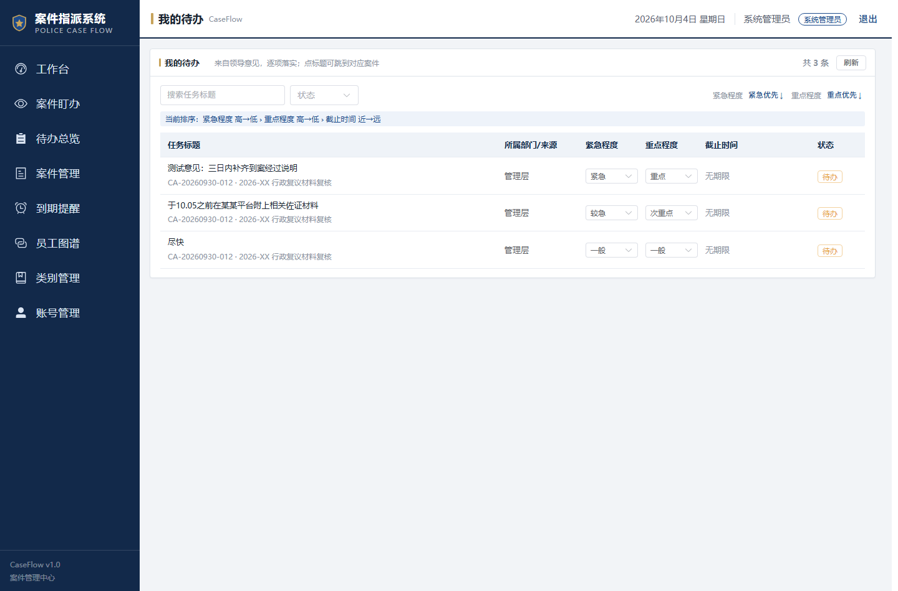

# CaseFlow 案件指派系统 · 用户使用手册

> 版本 v2.0 ｜ 适用：纯内网桌面端 ｜ 面向：办案民警、组长、领导、系统管理员
> 本手册按「一个警察从早到晚怎么把案子办完」的顺序编排，图文对应，看到哪一步就照做哪一步。

---

## 目录

1. 认识这套系统（30 秒导读）
2. 登录与账号
3. 角色与权限：你能看到什么、能做什么
4. 案件类型与三级浏览：找到案子的正确姿势
5. 我的案件 / 我的待办 / 到期提醒：每天先看这三处
6. 建案：一份完整新案件怎么录
7. 指派：把案子交到人手上
8. 领导意见与待办：系统的核心协作机制
9. 办案阶段：初查 → 刑拘 → 取保的推进
10. 案件盯办：两类案件的两套盯法（重点）
11. 办理时限：刑事与行政的两套时钟（重点）
12. 重点关注：四个栏目里的金色星标
13. 操作记录与撤回：点错了怎么办
14. 系统管理员：账号 / 员工图谱 / 类别管理
15. 常见问题

---

## 第 1 章 认识这套系统（30 秒导读）

**一句话**：CaseFlow 把「收到案子 → 指派给人 → 盯着别超期 → 办完结案」这条链路搬到线上，每一步谁做了什么、什么时候做的，都留痕、可撤回。

**它解决的三个痛点**：

- **案子派出去不知道办到哪了** —— 领导意见变成「待办」，办完必须回填反馈，进度实时可视。
- **期限容易记漏** —— 刑事的羁押期限、行政的 30 天办结期，系统按天倒计时，临期和逾期都在「到期提醒」里红着。
- **改错了没法追** —— 每一次写操作都自动存「改前/改后」双快照，一键撤回。

**四个角色，看到的菜单不一样**（详见第 3 章）：

| 角色 | 通俗说法 | 主要能干什么 |
|---|---|---|
| BOSS 局长 | 一把手 | 全部权限 |
| CHIEF 所长 / 大队长 | 中层领导 | 全部权限 |
| DEPUTY_CHIEF 副职 | 副职领导 | 全部权限 |
| LAW_OFFICER 法制 | 法制岗 | 全部权限 |
| STAFF 民警 | 普通办案人 | 只能看/办自己相关的案子 |

> 前四个统称「管理层（全权限）」，前端权限开关叫 `isFullAccess`。第 8 章那条「勾选完成待办」，只有管理层能点。

---

## 第 2 章 登录与账号

### 2.1 登录

打开浏览器访问内网地址（形如 `http://10.x.x.x:8080/api/`），输入**手机号 + 密码**登录。


> 小提示：本系统是纯桌面端内网应用，用电脑浏览器打开，不用手机。

### 2.2 注册（自助申请）

没有账号的同事，在登录页点「注册」，填写姓名、手机号、密码、选择所属部门与职务，提交后**等待管理员审核**。

**三条硬规则**：

1. **手机号全局唯一** —— 一个人只能有一个账号，重复注册会被拦。
2. **审核通过（`audit_status = 1`）才能登录** —— 刚注册完登录会被提示「账号待审核」。
3. **忘记密码** —— 找管理员在「账号管理」里重置，重置后原密码立即失效。

### 2.3 审核与常见登录失败

| 提示 | 原因 | 怎么办 |
|---|---|---|
| 账号或密码错误 | 输错，或账号被停用 | 核对后重试；仍不行找管理员 |
| 账号待审核 | 刚注册没审核 | 联系管理员点「审核通过」 |
| 账号已停用 | 管理员停用了账号 | 联系管理员 |

---

## 第 3 章 角色与权限：你能看到什么、能做什么

### 3.1 侧栏菜单按角色显示

左侧导航栏的菜单项**不是人人一样**。系统管理员能看到「账号管理 / 员工图谱 / 类别管理」，普通民警看不到——不是坏了，是没权限。

### 3.2 权限速查

| 动作 | 谁能做 |
|---|---|
| 建案、指派、编辑案件 | 管理层 |
| 办结、撤销、删除案件 | 管理层 |
| 添加/流转办案阶段 | 管理层确认流转 |
| 勾选「待办已完成」 | **仅管理层**（民警只能提交反馈，不能自己勾掉） |
| 登记自己的办理时间 | 本案承办人本人 |
| 登记「审核通过并接收」 | 仅管理层 |
| 登记「确认延长办案期限」 | 仅管理层 |
| 撤回一条操作 | 该操作的执行人或管理层 |

> **重要**：第 8 章会讲，一条待办「办完了」不等于「完成了」——民警提交反馈后，仍需**领导勾选**才算真正完成。这是防止「自己说办完了」的硬规则。

### 3.3 三件事只有「本案现职承办人本人」能做

1. 提交某条待办的**执行反馈**
2. **登记实际办理时间**（如第 3 天内部监督的实际完成日）
3. 在盯办抽屉里登记与本案相关的节点

不是本案承办人，这些按钮点了会被拦。

---

## 第 4 章 案件类型与三级浏览：找到案子的正确姿势

**这是首次使用必须掌握的一步。**

### 4.1 三级浏览：大类 → 小类 → 案件列表

系统把案件按「大类 → 小类 → 栏目页」三级组织：

1. **第一级：案件类型选择页**（`/case-type`）—— 三张大卡片：**刑事 / 行政 / 其他**。
2. **第二级：小类卡片页**（`/case-boards`）—— 选完大类后，展示该大类下的各个小类（如刑事下的「接触性诈骗 / 电信诈骗 / 盗窃」等），每张卡片显示该小类的案件数。
3. **第三级：栏目页** —— 最终落到案件列表 / 盯办 / 待办总览等具体页面，并带上筛选条件。


*▲ 第一级：案件类型选择页。刑事 17 件、行政 6 件、其他 1 件，点卡片进入下一级。*


*▲ 第二级：行政案件的小类卡片。每张卡右上角是该小类的案件数。*

### 4.2 三条要记住的规则

- **选完大类必过小类页** —— 系统强制先选小类（可点「全部」小类卡跳过细分），再进栏目页。
- **顶部「案件类型」条会跟着变** —— 进入某类型后，顶部会出现一条「当前案件类型：刑事案件 / 行政案件」的提示条，**统计与检索都限定在该类型内**。切类型要用顶部类型条右侧的按钮。
- **退出逐级退回** —— 顶部「返回类别」按钮会按层级变形：在栏目页点它退回小类页，在小类页点它退回大类型选择页。

> **「其他」是什么？** 指既不是刑事也不是行政的案件（含案件类型为空的）。它是**查询口径**，不是一种存储类型。若某案件没归入刑事/行政，就会出现在「其他」里。

---

## 第 5 章 我的案件 / 我的待办 / 到期提醒：每天先看这三处

### 5.1 每次登录先看「欢迎回来」

工作台顶部会有一句「欢迎回来，XXX」，并直接给出你**手头未完成的待办数量**。侧栏「我的待办」旁边的红点就是这个数字——**口径与任务页完全一致**，不会出现「侧栏 3 条、点进去 6 条」的情况。

> 红点 = **未完成待办总数**（不论有没有期限）。这是 2026-10-14 统一后的口径。

### 5.2 我的案件（`我的案件`）

这里是**与你有关**的案件（你是主办、协办或被指派的）。列表默认只显示当前案件类型下的案子，过期/临期用底色和左侧色条标出。

### 5.3 我的待办（`我的待办`）

你手头所有待办事项的清单，**默认筛选「待办」状态**（只看还没做完的）。



*▲ 我的待办列表。默认只看未完成，可按关键词 / 状态 / 紧急程度筛选。*

### 5.4 到期提醒

按案件聚合的期限告警：哪些案子「今天到期」「3 天内到期」「已逾期」。**刑事和行政分别有自己的告警**，因为两套时钟不一样（详见第 11 章）。

### 5.5 民警的完整干活流程（推荐动作顺序）

1. 登录 → 看侧栏红点，知道有几件事等着办。
2. 进「我的待办」，按紧急程度从高到低处理。
3. 每办完一条，进案件详情**提交反馈**，等领导勾选完成。
4. 盯着「到期提醒」，别让自己承办的案子超期。
5. 需要推进阶段时，发起流转，等领导确认。

---

## 第 6 章 建案：一份完整新案件怎么录

在「案件管理」列表**最右端**点「新建案件」。


*▲ 案件管理列表（刑事）。「新建案件」按钮固定在筛选行最右端，不随窗口宽度跑位。*

建案表单分五个区块，其中**只有基础信息和案件类型是必填**，其余都是选填、可跳过。

### 6.1 区块一：基础信息

| 字段 | 说明 | 必填 |
|---|---|---|
| 案件名称 | 一句话说清是什么案 | ✅ |
| 案件类型 | 刑事 / 行政 / 未立案（决定走哪套流程） | ✅ |
| 案件类别（小类） | 从已有类别里下拉选，不手打 | |
| 来源 | 手工 / PDF / Word / Excel | |
| 案件编号 | 可自动生成，也可手填 | |
| 发案地点 / 发案时间 | | |
| 受案时间 | **行政案件必看此项**，是行政期限的起算基准 | |
| 优先级 | 普通 / 紧急 / 特急 | |
| 是否采取强制措施 | 开关；打开后选具体措施 | |

### 6.2 区块二：重要时间节点（选填，可多个）

可以录入多个时间节点，例如「受案时间」「立案时间」「刑事拘留期限届满」等。每个节点可设**提前提醒天数**。

### 6.3 区块三：嫌疑人（选填，可多个）

录入姓名、性别、身份证号、联系电话等。列表里会用「张三等N人」的摘要显示。

### 6.4 区块四：待办事项（选填，可多条）

建案时就可以给承办人派几条初始待办。

### 6.5 区块五：立即指派（可跳过）

可以直接在建案时选好主办 / 协办，也可以先建后派。

### 6.6 提交与校验

点「提交」后，前端会做必填校验；后端还会校验案件编号是否重复、类别是否合法等。校验不通过会在对应字段下方红字提示。

---

## 第 7 章 指派：把案子交到人手上

在案件列表某行的「操作」列点「指派」（或进详情后指派）。

### 7.1 四个字段

| 字段 | 说明 |
|---|---|
| 主办人 | 主办民警（1 人） |
| 协办人 | 协办民警（可多个） |
| 办案组别 | 系统按案件要求的组别自动筛选可选人员 |
| 待办事项 | 可顺手把事派下去 |

> **字段名注意**：接口里的参数是 `ownerId`（主办）+ `memberIds`（协办），不是 `owners` / `members`。这是开发约定，用户不用管，但报 500 时多半是这里。

### 7.2 办案组别：谁该接什么案

系统按「案件要求的组别」过滤可选人员，规则如下：

| 案件阶段 | 要求组别 | 说明 |
|---|---|---|
| 初查 | **初查组** 或 不限 | 初查阶段由初查组承接 |
| 刑拘在办 | **清案组** 或 不限 | 刑拘后的清案流程由清案组承接 |
| 取保及监居 / 行政 / 未立案 | 不限 | 不限制组别 |

**「不限」组是机动力量**：可以接任何案件。唯一被拦的是「初查组 ↔ 清案组」互换——两个专业分工不互派。

> 组别的权威来源是**员工档案**（`org_employee.police_group`），不是账号。

### 7.3 提交与提示

提交后案件状态从「待指派」变为「已指派」。若选的承办人不符合组别要求，会被拦并提示。

---

## 第 8 章 领导意见与待办：系统的核心协作机制

**这是整套系统的心脏**：领导提的意见，自动变成承办人的「待办」；办完必须回填反馈，领导再勾选完成。

### 8.1 一条待办的产生

**领导意见是待办的唯一载体**：

```
领导提意见  →  系统派生一条待办  →  承办人看到待办  →  办理后提交反馈  →  领导下拉勾选「已完成」
```

一条待办记录了自己**来自哪条意见**（`opinion_id` 派生），所以「意见 → 待办」永远对得上，不会两处数字打架。

### 8.2 三处录入，同一张表格

待办可以从三个入口录入（建案时、指派时、案件详情里），但**底层是同一张表、同一条链路**。批量录入用 `TodoBatchEditor` 组件。

### 8.3 待办面板：领导看到什么 / 民警看到什么

- **领导**：看到自己派的每条意见的落实状态（已完成 / 进行中 / 未完成）。
- **民警**：看到「我该办什么」，按紧急程度排序，办完点「提交反馈」。

### 8.4 完成一条待办的完整流程（含两个硬规则）

1. 承办人办完后，点「提交反馈」，写清怎么办的。
2. 反馈提交后，待办状态仍是「待办」——**不会自动变成已完成**。
3. **领导（或管理员）勾选「已完成」，这条待办才算真正闭环。**

**两个硬规则**：

- ⚠️ **勾选完成只允许领导与管理员** —— 办案民警不能自己勾掉（2026-10-13 明确）。
- ⚠️ **汇报要弹完整弹窗** —— 勾选子任务时不能直接勾掉，必须填完整的汇报内容。

### 8.5 子任务

一条待办下可以挂**两级子任务**（`parent_id`，最多两级）。主任务的权限归管理层，子任务归承办人。

---

## 第 9 章 办案阶段：初查 → 刑拘 → 取保的推进

### 9.1 四个阶段

案件办理分四个大段落，**案子永远处在其中一个阶段**：

| 阶段 | 说明 |
|---|---|
| **初查** | 接收材料 → 立案 → 侦查 → 判断是否符合刑拘条件 |
| **刑拘在办** | 刑事拘留期间的办理 |
| **取保及监居** | 取保候审 / 监视居住的执行 |
| **已终结** | 案件办理完毕 |

> 案件刚建好、`flow_stage` 为空时，系统**一律按「初查」处理**——这是归位口径，不会出现「无阶段」的孤儿案件。

### 9.2 进度怎么算（关键设计）

**阶段任务 = 案件待办**。这是本系统一个重要的简化：

> 一个阶段的待办**全部办完**，才由领导确认转入下一阶段。进度**不落库、实时算**——待办表上记了每件事属于哪个阶段，流转后新阶段从 0 起算，进度天然归零。

**为什么要这样设计？** 旧版本维护了「环节 → 标准任务」三层模板，建案时自动铺 13 项标准任务，结果和民警日常用的「案件待办」变成**两套并行清单**——同一个案子要在一处勾「接收材料/立案/侦查」，又要在另一处勾领导交代的事，两处数字永远对不上。现在只有**一份清单**，彻底消除了这个问题。

### 9.3 流转：做完不自动跳，必须领导点确认

即使某阶段待办全办完了，系统**不会自动跳阶段**。页面顶部会亮起「本阶段待办已办完，可进入下一阶段」，需要**领导点确认**才流转。


*▲ 刑事案件的详情抽屉。下方可见「案件待办」「重要时间节点」「嫌疑人」三个区块。*

### 9.4 流转出口（重要，刑事 / 行政各不同）

**刑事案件**（主干两条线）：

```
初查 ──刑拘──▶ 刑拘在办 ──取保候审──▶ 取保及监居 ──解除收案──▶ 已终结
                    │
                    ├──逮捕──▶ 已终结
                    └──释放──▶ 已终结
```

- 初查**唯一出口**是「刑拘」——不提供「直接取保」「直接释放」。没经过刑拘就取保，强制措施和承办组别会与实际脱节。

**行政案件**（一条线）：

```
初查 ──批准行政处罚──▶ 已终结
```

> **注意**：刑事案件被指定承办给「刑拘在办」阶段时，系统会提示改派**清案组**。

---

## 第 10 章 案件盯办：两类案件的两套盯法（重点）

「案件盯办」是领导和中层最常用的页面。它按**大类拆分**，刑事和行政的盯法**完全不同**。

### 10.1 页面结构


*▲ 案件盯办 · 刑事。顶部四张卡片：初查案件 / 刑拘在办 / 取保及监居 / 待审批。下方三张图表 + 案件列表。*

页面自上而下：

1. **顶部四张状态卡**：初查 / 刑拘在办 / 取保及监居 / 待审批，各显示数量与异常（计划逾期、有嫌疑人、临期、30 天到期、剩 ≤2 天）。
2. **具体时限提醒**：红色/橙色列出临期与逾期的具体案件和节点。
3. **三张图表**：在办案件构成（环形图）、办案期限分布（条形图）、各小类案件数（点图例可下钻）。
4. **案件列表**：底部，可按状态 / 案件类别 / 嫌疑人 / 身份证 / 经办人 / 侦查进度筛选。

### 10.2 刑事盯办：三个页签

刑事案件列表按**盯办子模块**分三个页签，每个页签盯的东西不同：

| 页签 | 盯什么 | 状态列口径 |
|---|---|---|
| **初查** | 案件有没有被分配、签收、反馈 | 四态：未分配 → 已分配 → 已签收 → 已反馈 |
| **刑拘在办** | 承办人办理进度 | 三态：未开始 → 进行中 → 已完结 |
| **取保及监居** | 取保/监居执行与盯办 | 三态：未开始 → 进行中 → 已完结 |

**强制措施如何归类到页签**（同一套映射，全系统统一）：

| 强制措施 | 归入页签 |
|---|---|
| 无 / 空 / 拘传 | **初查**（拘传只是到案手段，不改变"是否在押"） |
| 拘留 / 逮捕 | **刑拘在办**（都是羁押类，阶段任务相同） |
| 取保候审 / 监视居住 | **取保及监居** |

### 10.3 行政盯办：只看期限节点

行政案件的盯办页面**只有案件列表和期限节点**，没有刑事那套强制措施页签。


*▲ 案件盯办 · 行政。核心是「具体时限提醒」，逐条列出行政案件的第 3/10/20 天内部监督节点。*

### 10.4 侦查详情抽屉

点案件行右侧的「详情」按钮，弹出盯办抽屉，里面有三块：


*▲ 刑事盯办抽屉（拘留案）。含「具体时限与提醒」「主办人与盯办人」「强制措施与期限」「办案阶段」「案件待办」五块。*


*▲ 行政盯办抽屉。核心是居中的「办理节点」表：第 3/10/20 天内部监督 + 第 30 天办结 + 延长 30 天，每个节点都能「录入时间」。*

---

## 第 11 章 办理时限：刑事与行政的两套时钟（重点）

**这是刑事 / 行政细节差别最大的地方，务必看懂。**

### 11.1 通用起算口径

> **起算当日 = 第 1 天。第 N 天 = 起算日 + (N−1) 天。**

例如起算日是 10 月 1 日，那么「第 3 天」就是 10 月 3 日。到期时间当天 23:59:59，提醒从当天 00:00 生效。

### 11.2 刑事 · 拘留（刑拘）：按羁押期限分三种

拘留的羁押期限有 **3 天 / 7 天 / 30 天** 三档，由**刑拘日期**起算，不同档位生成不同的时限节点：

| 档位 | 系统生成的节点 |
|---|---|
| **3 天案** | 「第 3 天变更羁押期限（改 7 天/30 天/停止计算）」——3 天内必须决定下一步 |
| **7 天案** | 第 4 天提醒移交预审或法制 → 第 5 天移交预审 → 第 6 天移交法制 → 第 7 天刑拘届满 |
| **30 天案** | 第 12 天提醒移交 → 第 15 天移交预审 → 第 19 天跟进审核进度 → 第 20 天移交法制 → 第 30 天刑拘届满 |

**7/30 天案还有两个附加节点**：预审审核通过并接收、法制审核通过并接收（须**管理层**根据回执登记）。

> **变更羁押期限**（管理层操作）：可选「改为 7 天」「改为 30 天」「停止计算（精神病鉴定）」「恢复计算」。停止计算期间，所有时限**暂停不提醒**。

### 11.3 刑事 · 取保候审

以**取保日期**起算：

| 节点 | 期限 |
|---|---|
| 移交预审（可呈二次逮捕） | 3 个月内 |
| 移交法制 / 评估解除取保 | 半年内 |
| 取保候审期限届满 | 1 年 |
| 传讯并录入时间 | 每 3 个月至少一次 |

### 11.4 刑事 · 监视居住

以**监居日期**起算：

| 节点 | 期限 |
|---|---|
| 监视居住期限届满 | 6 个月 |
| 每月传讯提醒 | 每月 |
| 距上次传讯不得超过 | 3 个月 |

### 11.5 行政案件：以「受案时间」起算

行政案件**没有强制措施那套**，它的时钟基于**受案时间**：

| 节点 | 期限 | 说明 |
|---|---|---|
| **第 3 天所内部监督** | 受案后第 3 天 | 内部监督节点 |
| **第 10 天所内部监督** | 受案后第 10 天 | |
| **第 20 天所内部监督** | 受案后第 20 天 | |
| **第 30 天办结** | 受案后第 30 天 | 未办结需呈**延长文书** |
| **确认延长 30 天** | 第 30 天 | 确认后总期限变 60 天 |
| **第 60 天** | 延长后第 60 天 | 已延长则第 60 天前呈延长文书 |

> **行政案件必须登记「受案时间」，否则整套行政时限不生成。** 受案时间在案件详情里录。

### 11.6 谁有权限登记什么

| 操作 | 权限 |
|---|---|
| 登记办理时间（内部监督等） | 本案承办人 |
| 「审核通过并接收」 | 仅管理层 |
| 「确认延长办案期限」 | 仅管理层 |
| 「变更羁押期限」 | 仅管理层 |

---

## 第 12 章 重点关注：四个栏目里的金色星标

### 12.1 是什么

「重点关注」是一个**星标**。标了星的案件，在各列表的**第一列**会显示金色左边条，可一眼扫出。

### 12.2 怎么标 / 谁能标

在案件列表点行首的星标图标即可切换。管理层可标记，普通民警只读。

### 12.3 「只看重点」开关

各列表筛选行最左端有「只看重点」筛选片，打开后**列表和图表同步只显示重点案件**（图表与列表同一口径，不会一个筛了一个没筛）。

---

## 第 13 章 操作记录与撤回：点错了怎么办

### 13.1 在哪看

「操作记录」面板（一般在案件详情或独立入口）列出所有写操作，每条可展开看详情。

### 13.2 撤回机制（本系统的亮点）

**每一次写操作，系统都自动存两份快照**：

- **改前**（before）：操作前的完整数据
- **改后**（after）：操作后的完整数据

**撤回 = 把「改前快照」原样写回。**

> **撤回本身也是一次写操作**——所以撤回也会被记一笔日志。对一次「撤回」再撤一次，就等于「重做」。

### 13.3 撤回的规则

| 规则 | 说明 |
|---|---|
| 谁能撤 | 该操作的执行人，或管理层 |
| 撤几次 | 可反复撤（撤完再撤=重做） |
| 撤回留痕吗 | 留，撤回本身记日志 |
| 影响 | 撤回是覆盖写，请确认清楚再点 |

---

## 第 14 章 系统管理员：账号 / 员工图谱 / 类别管理

只有管理层能看到这三个菜单。

### 14.1 账号管理（`账号管理`）

- **审核**：新注册账号点「审核通过」才能登录。
- **停用 / 删除 / 重置密码**：这三个动作都会**强制清除该用户的登录态**（`removeAll`），被操作的人需要重新登录。
- **改手机号**：手机号全局唯一，改重复会被拦。

### 14.2 员工图谱（`员工图谱`）

展示组织架构与人员档案。**员工的「办案组别」在这里维护**（初查组 / 清案组 / 不限）——这是指派校验的权威来源。

> 层级由**职务推导**：总 → 副总 → 组长 → 员工。部门必须从已有部门里下拉选，手打的部门会被标橙提示。

### 14.3 类别管理（`类别管理`）

维护案件**小类**（如刑事下的「接触性诈骗」）。建案时的「案件类别」下拉就是读这里的。

---

## 第 15 章 常见问题

**Q1：为什么我点某个菜单没反应 / 页面被弹回来？**
多半是没有权限，或没有先选案件类型。本系统有「案件类型门控」——进入某类页面须先经过类型选择。

**Q2：为什么勾选框点不动？**
该勾选（如「待办已完成」）只有**管理层**能点，民警请改用「提交反馈」。

**Q3：我提交了反馈，为什么待办还是「待办」？**
这是设计如此——民警提交反馈 ≠ 完成，需**领导勾选**才闭环。

**Q4：为什么列表里看不到「截止期限」的具体日期？**
列表里**只显示「剩余 N 天 / 已逾期 N 天」**，具体日期点进案件详情看。这是刻意的，避免列表太挤。

**Q5：行政案件为什么没有期限提醒？**
检查是否登记了「受案时间」——行政时限以受案时间为起算基准，没登记就不生成。

**Q6：案件怎么一直显示「待指派」？**
还没指派承办人。指派后变为「已指派」。

**Q7：为什么侧栏红点是 3，点进去却有 6 条？**
现在不会了——红点口径已统一为「未完成待办总数」，与任务页一致。

**Q8：改错了怎么办？**
进「操作记录」找到那条操作，点撤回。撤回=写回改前快照，且会再记一笔日志。

---

> 本手册对应系统 v1.0（2026-10）。如界面与实际有出入，以系统实际为准；功能细节变更请见《案件指派系统 · 设计思路与开发路线》。
