# 案件指派系统 · 看图就会用

这本手册教您用这个系统。**一页一图，照着图找位置就行。**

---

# 第 1 页　先登录

打开浏览器，在地址栏输入单位给的网址，按回车。

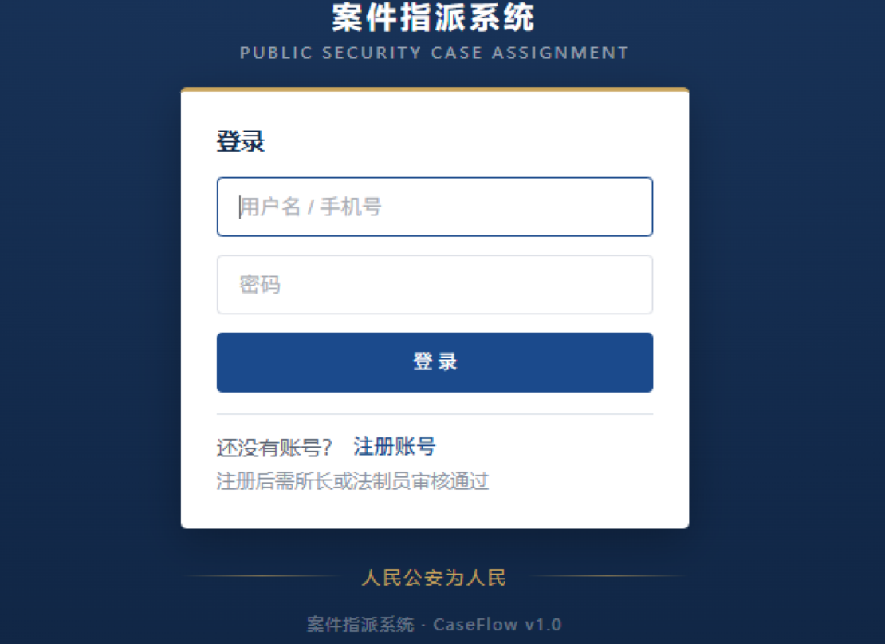

**照着做三步**：

1. 在两个框里分别填 **用户名** 和 **密码**
2. 点蓝色的 **「登 录」** 按钮
3. 没账号？点下面 **「注册账号」**（注册后要等领导审核通过）

**忘了密码**：找管理员重置，不用自己试。

---

# 第 2 页　您是什么角色

**不用记**。只看一件事：**左边菜单有几项，就说明您是什么角色。**

| 左边菜单 | 您的角色 | 能做什么 |
|---|---|---|
| 3 项 | **民警** | 只看自己名下的案件，完成领导交办的事 |
| 5 项 | **领导** | 建案、指派、盯进度、撤回 |
| 8 项 | **管理员** | 领导的权力，另外管账号、管人员 |

> **民警**的菜单：我的案件、我的待办、到期提醒
> **领导**的菜单：工作台、案件盯办、待办总览、案件管理、到期提醒

---

# 第 3 页　领导：每天先看工作台

登录后第一眼就是这个页面。

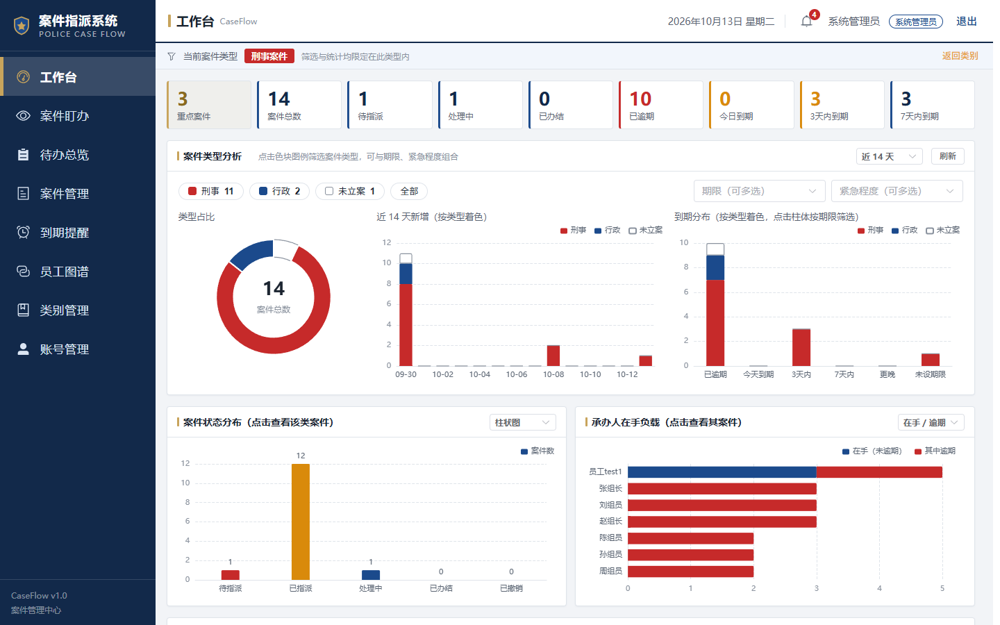

**最上面一排数字，点哪个跳到哪个：**

| 看到的字 | 意思 |
|---|---|
| **重点案件** | 领导标了星的要紧案子 |
| **案件总数** | 现在一共多少案 |
| **待指派** | 还没派给人手的 |
| **已逾期**（红字） | **超期了，要马上处理** |
| **今日到期 / 3天内 / 7天内** | 快到期的 |

**下面三块图**：看案件类型、看新增加多少件、看哪些快到期。

> **每天上班第一件事：先看「已逾期」那个数。**

---

# 第 4 页　领导：新建一个案件

左边点 **「案件管理」**，再点右上角蓝色 **「新建案件」**。

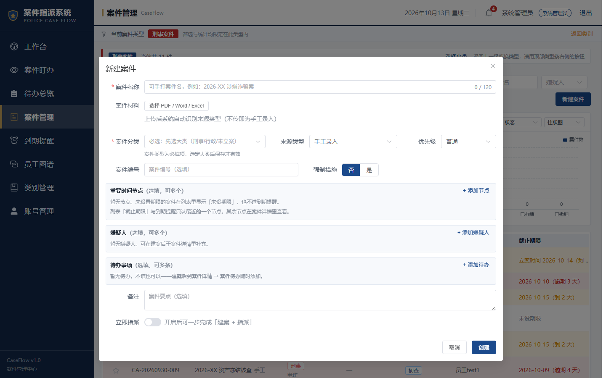

**必填两项**（前面有红色星号）：

1. **案件名称** —— 自己打字，如「2026-XX 涉嫌诈骗案」
2. **案件分类** —— 必须选大类（刑事 / 行政 / 未立案）

**可填可不填**：案件编号、优先级、强制措施、备注。

**三个可展开的区域**（点蓝字才展开，不理也行）：

| 区域 | 什么时候用 |
|---|---|
| **重要时间节点** | 有立案、拘留等关键日期时 |
| **嫌疑人** | 已知嫌疑人时 |
| **待办事项** | 想在建案时就把要办的事派下去 |

填完点右下角 **「创建」**。

---

# 第 5 页　领导：把案子派给人

在案件列表里找到要派的案子，点右边 **「指派」**。

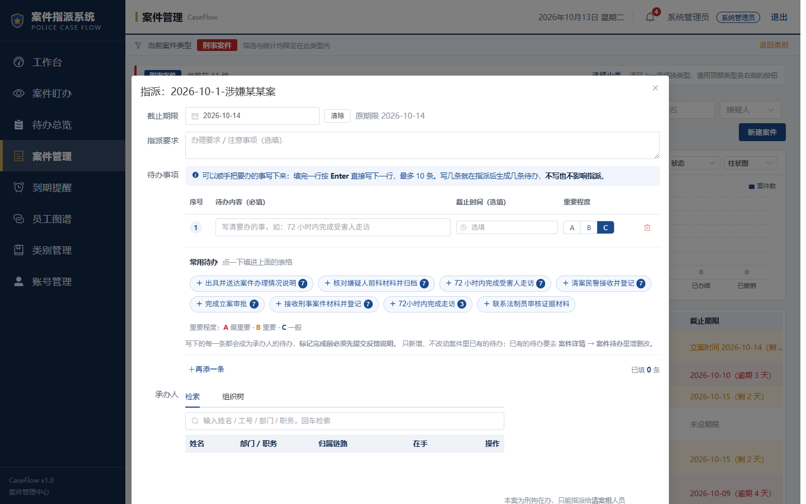

**从上往下填**：

1. **截止期限** —— 什么时候之前办好（可不填）
2. **指派要求** —— 用大白话交代，如「三天内要出现查证材料」
3. **待办事项** —— 把要办的事一条条列出来（下一页细讲）
4. **承办人** —— 搜名字 → 点「**主办**」

填完点右下角 **「确认指派」**。

> **一定要选承办人**，不然提交不了。

---

# 第 6 页　写待办（三处都一样）

**这三个地方写待办的方法完全一样**：案件详情里点「添加」、指派弹窗里、建案弹窗里。

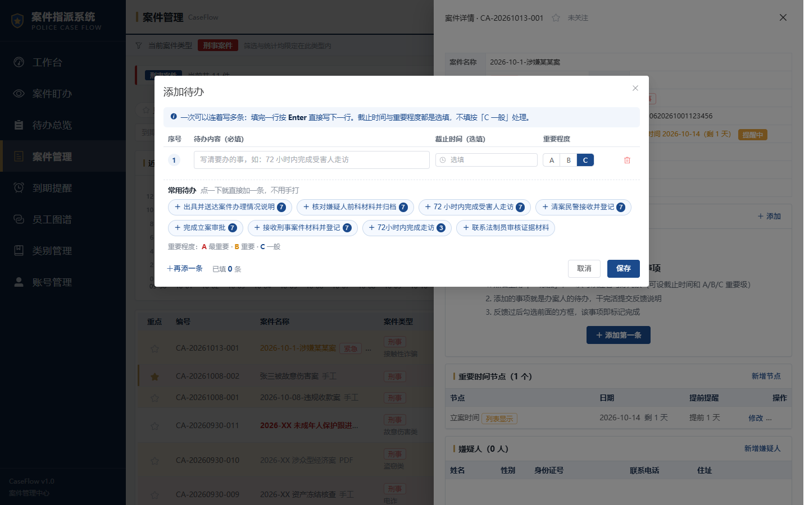

**在格子里填**：

| 格子 | 填什么 |
|---|---|
| **待办内容** | 必填。写清要办的事，如「72 小时内完成受害人走访」 |
| **截止时间** | 可填可不填 |
| **重要程度** | **A** 最要紧 → **B** 重要 → **C** 一般 |

**三个省事的小窍门**：

1. **按回车键** 换到下一行，接着写第二条
2. 下面有 **「常用待办」** 小标签 —— 您以前写过的，点一下**自动填进来**
3. 点 **「+ 再添一条」** 手动加行

一次最多写 **10 条**。

> **A / B / C 怎么选？**
> **A** = 今天必须办　**B** = 这几天要办　**C** = 不急有空办

---

# 第 7 页　领导：看谁在办、办得怎么样

左边点 **「案件盯办」**。

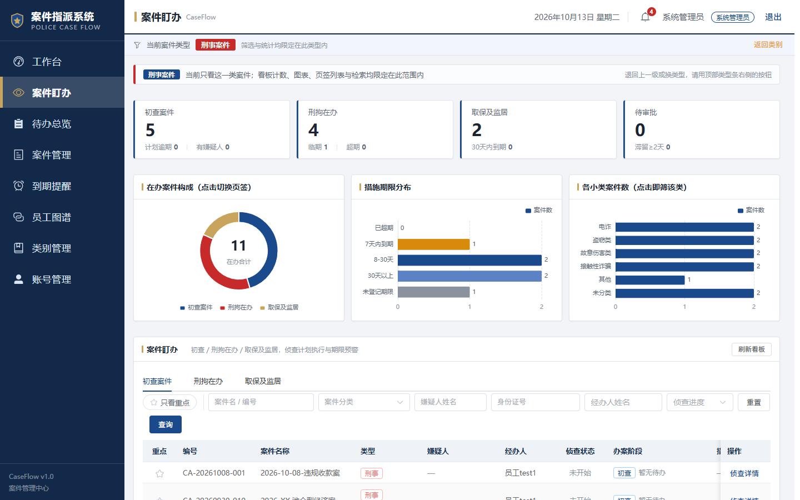

**上面四块看板**，点哪个看哪一类：

- **初查案件** —— 还在最初的调查阶段
- **刑拘在办** —— 刑事拘留中的案子，**最需要盯**（临期、超期都在这）
- **取保及监居** —— 取保候审、监视居住的案子
- **待审批** —— 等您批的，**滞留 2 天以上会标红**

**表格里点「侦查详情」**：

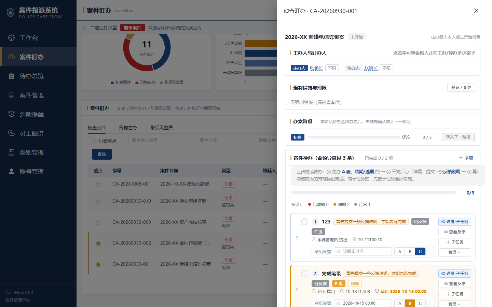

打开后看到四块：**主办人** → **强制措施** → **办案阶段** → **案件待办**。

**重点看「办案阶段」那块**：

```
初查 ──本阶段待办全办完──▶ [ 转入下一阶段 ]
```

办完就点 **「转入下一阶段」**，案子往下走一步。没办完也能转。

---

# 第 8 页　领导：怎么催、怎么补救

### 盯住要办的案子

在案件列表，点案件名前面的 **★ 星标**，这案子就变成金色的「重点案件」。

**四个地方**（工作台 / 案件盯办 / 待办总览 / 到期提醒）都能看到重点案子。

### 抓重点看

每个列表上方都有 **「只看重点」** 勾选框，勾上以后**只显示重点案子**。

### 点错了怎么办

工作台右下角 **「最近操作」** 那里，点 **「撤回上一步」**（也能按 Ctrl+Z）。

**只能撤回最近那一步。**

---

# 第 9 页　民警：每天开工看这里

左边点 **「我的待办」**。

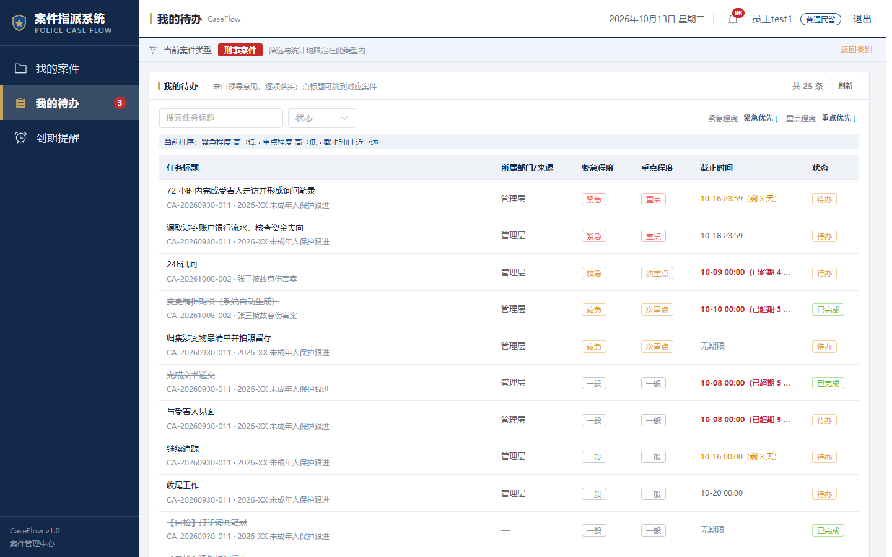

**领导交代的事都在这里**，按要紧程度排好了。

**认这几个颜色**：

| 看到什么 | 意思 |
|---|---|
| 红色 **已超期** | **晚了，赶紧办** |
| 橙色 **剩 3 天** | 快到期了 |
| 绿色 **已完成** | 办好了 |
| **紧急 / 重点** 标签 | 领导特别强调的 |

### 办完了怎么交差 —— 两步，顺序不能反

**第一步：写反馈**

点待办右侧 **「提交反馈」**：

1. 选 **落实状态**：**完成** / **进行中** / **未完成**
2. 写一句 **落实说明**（办成什么样了）
3. 点 **「提交反馈」**

**第二步：标完成**

反馈交上去后，**「标记完成」** 按钮才变亮，点它。

> **记牢这个顺序**：先写反馈 → 再标完成。
> 反过来做不了，「标记完成」是灰的点不动。

**标不了？** 检查两件事：① 子任务是不是没全做完 ② 一条反馈都没写。

---

# 第 10 页　民警：怎么进案件看细节

左边点 **「我的案件」**。

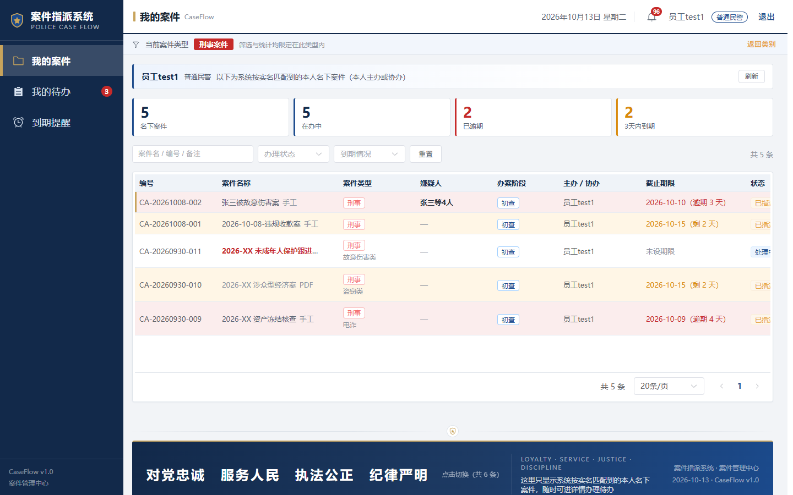

上面四个数字，点哪个就筛选哪个：**名下案件 / 在办中 / 已逾期 / 3天内到期**。

想看某个案子，点 **「详情」**，右边弹出详情：

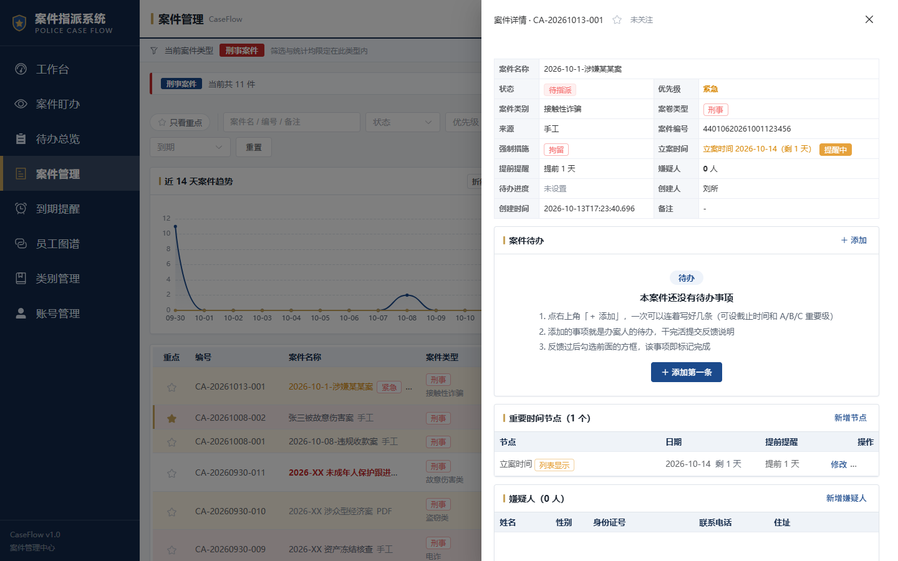

从上到下六块：**① 案件信息 → ② 案件待办 → ③ 重要时间节点 → ④ 嫌疑人 → ⑤ 现任承办人 → ⑥ 指派历史**

最下面按钮：

- **开始处理** —— 领办后点它
- **办结** —— 案子办完了
- **关闭** —— 关掉窗口

---

# 第 11 页　快到期的案子

左边点 **「到期提醒」**。

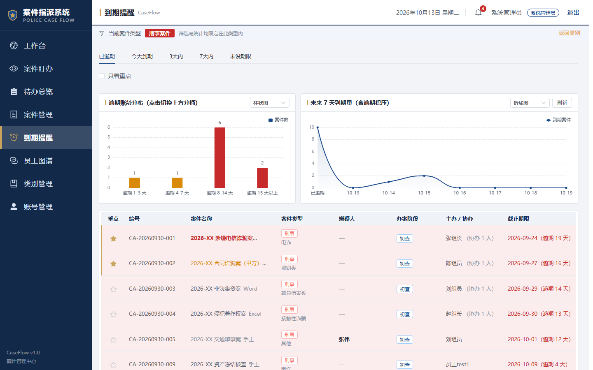

**上面五个页签**，按紧急程度排好了：

**已逾期** → **今天到期** → **3天内** → **7天内** → **未设期限**

点哪个页签就看哪一类。表格按到期时间从早到晚排，**最上面那个最急**。

---

# 第 12 页　领导：一眼看所有待办

左边点 **「待办总览」**。

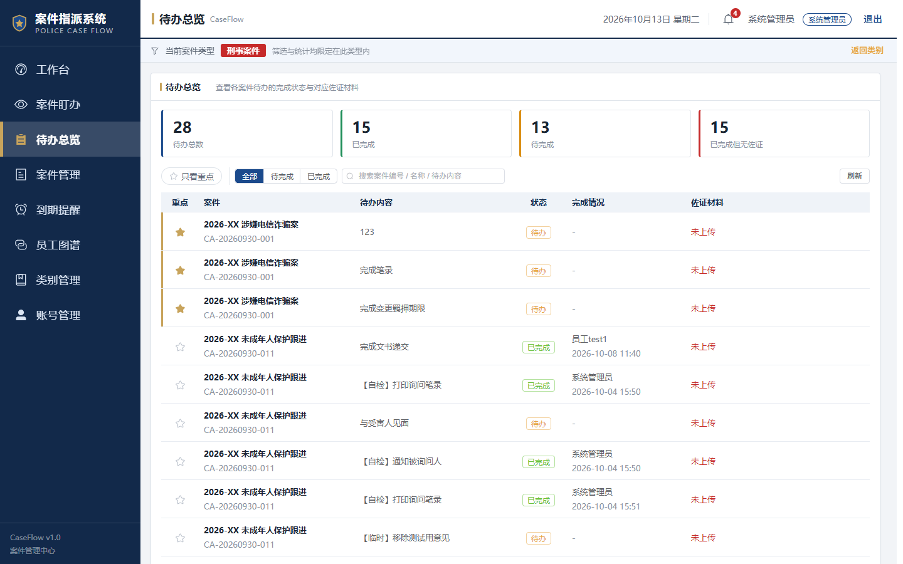

**上面四个数**：

- **待办总数** —— 一共派了多少事
- **已完成** / **待完成**
- **已完成但无佐证** —— **办完了但没交材料，要催**（红字）

**这一页只能看，不能改。** 要催就去「案件盯办」。

---

# 第 13 页　第一次用先选案件类型

**新账号第一次进**，或点上面几个栏目，系统会让您先选类型。

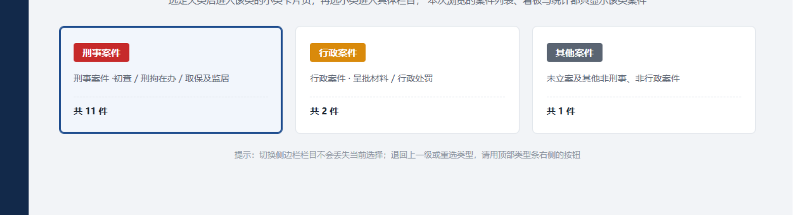

**三选一**：**刑事案件** / **行政案件** / **其他案件**

选了之后，所有列表、看板、统计**都只显示这一类**。

**想换类型**：点右上角 **「返回类别」**。

---

# 第 14 页　管理员：管账号、管人员、管类别

**只有管理员**能看到左边这三个菜单。

## 账号管理

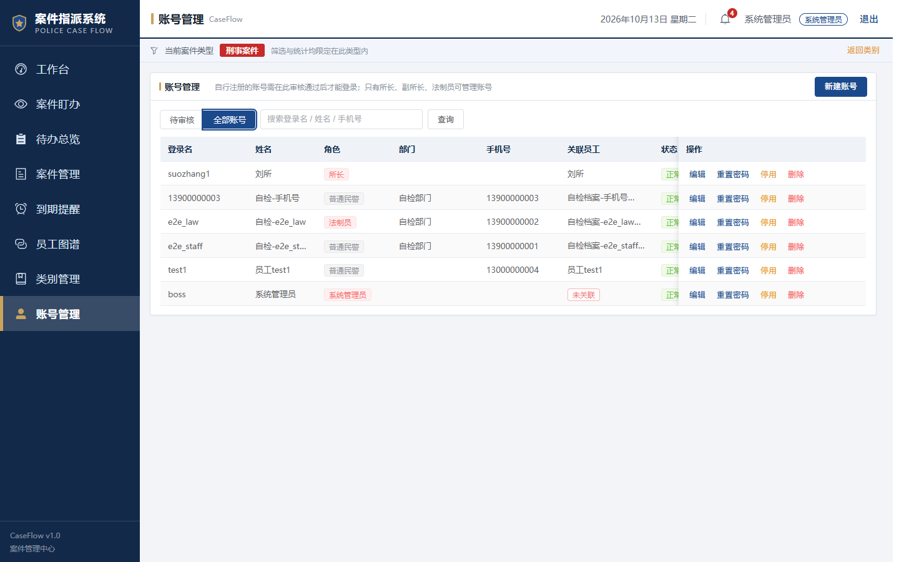

别人自己注册的账号，**要在这里点「通过」才能用**。

- **待审核** —— 新注册的人在等您批
- **全部账号** —— 点这里能改密码、停用、删除

## 员工图谱

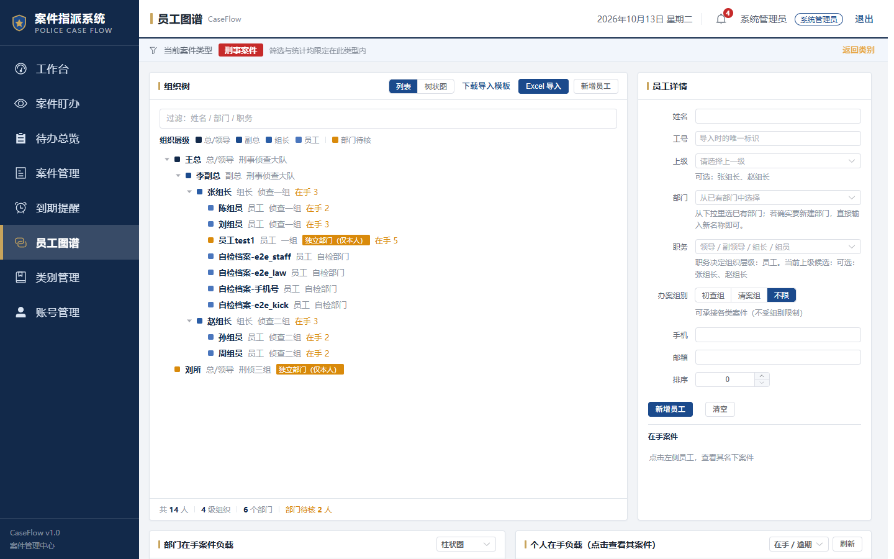

**左边是组织树**，点某个人，**右边能看到他的详细信息和在办案件**。

新来的民警，在这里点 **「新增员工」** 录进来。

> ⚠️ **重要**：账号必须**关联到员工**，否则他登录后看不到自己名下的案件。

## 类别管理

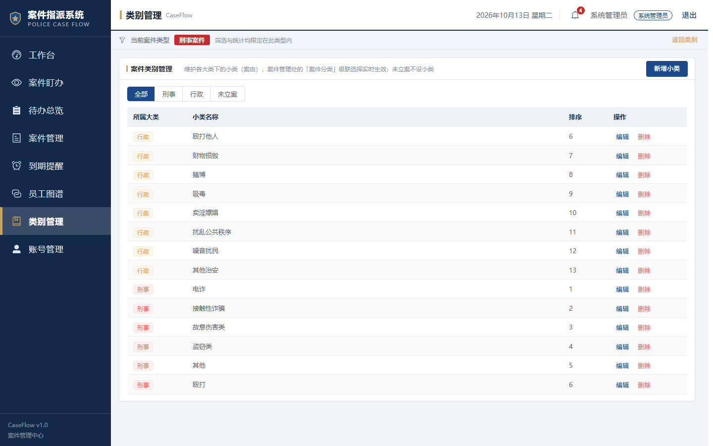

维护案件的小分类（如「电诈」「殴打他人」）。点 **「新增小类」** 加。

---

# 附录 1　名词解释

| 词 | 意思 |
|---|---|
| **承办人 / 主办** | 负责办这个案子的人 |
| **协办** | 协助主办的人 |
| **待办** | 领导派下来要办的具体事情 |
| **领导意见** | 领导交代的话，**会自动变成待办** |
| **办案阶段** | 案子走到哪一步：初查 → 刑拘在办 → 取保及监居 → 已终结 |
| **强制措施** | 刑事拘留、取保候审等强制措施 |
| **佐证材料** | 办完之后交的证明材料（照片、笔录等） |
| **重点案件 / ★** | 领导标记的要紧案子 |
| **撤回** | 把做错的一步退回去 |

---

# 附录 2　遇到问题怎么办

| 屏幕上出现 | 怎么办 |
|---|---|
| 「请至少选择一名承办人」 | 指派时忘了选人，退回去选 |
| 「请选择案件类型」 | 新账号第一次用，去选一下类型 |
| 「请填写案件名称」 | 建案时名称没填 |
| 「请选择采取的强制措施」 | 强制措施选了「是」，但没选种类 |
| 「标记完成」灰的点不动 | ① 子任务没全完成 ② 一条反馈都没写 |
| 「一次最多添加 10 条待办」 | 待办写太多，分两次加 |
| 「无权访问」或菜单少了几项 | 您没这个权限，找管理员 |
| 页面打不开 / 数据不对 | 找管理员，可能是服务停了 |

---

# 附录 3　记不住就看这张

```
民警每天：
登录 → 「我的待办」（看要办什么）
         ↓
    点「提交反馈」写一句
         ↓
    点「标记完成」交差
```

```
领导每天：
工作台（先看已逾期）
    ↓
案件管理（建案 / 指派）
    ↓
案件盯办（催进度）
```

---

*本文档与系统同步维护。如发现与系统实际不一致，以系统实际为准。*
